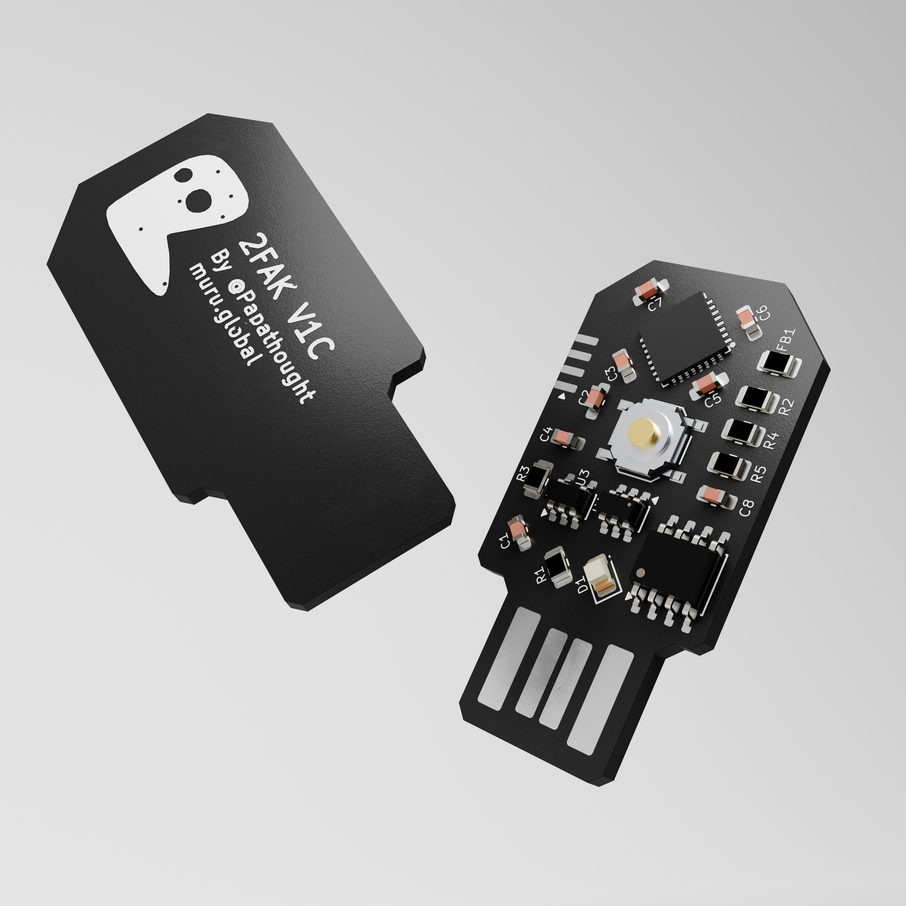
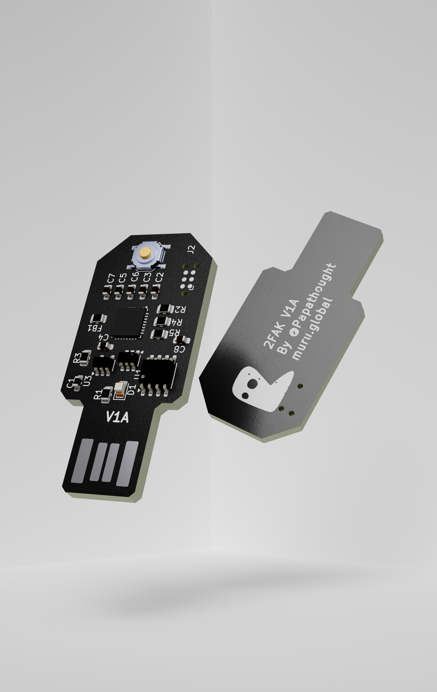

<div align="center">

# 2FAK

**Open-source USB hardware — a FIDO2 / WebAuthn security key, and a programmable USB dongle.**

_by muru.global_

[](LICENSE-APACHE)




<sub>2FAK V1C — the board <em>is</em> the USB-A plug: no cable, no moving connector.</sub>

</div>

---

2FAK is a small, affordable, fully open-source USB-A board that comes in two flavours:

- **2FAK (V1C)** — a finished **FIDO2 / WebAuthn security key**, running the **Resident
  (passkey) firmware**. It is the product most people want: phishing-resistant sign-in and
  passkeys, with a secure element and a locked-down debug port.
- **Programmable 2FAK (V1A / V1B)** — the same USB-A board as an **open, reflashable dev
  platform**. It ships with ready-made **HID Injection** and **Mouse Jiggler** firmware and can
  be reprogrammed into whatever you like.

- **USB VID/PID:** `0x1209 / 0x2FA2` (0x1209 is the pid.codes open-source Vendor ID; PID 0x2FA2 is registered to us)
- **AAGUID:** `c2aa81f8-352d-56e2-c689-2bfdb5a52ccc`
- **Firmware lineage:** fork of Nitrokey FIDO2 / SoloKeys solo1 (see `NOTICE`)

### 2FAK (V1C) — the security key

The flagship security-key edition. It **ships with the ATECC608B secure element populated by
default**, and **all SWD / debug pins are closed** (RDP-2 read-out protection), so firmware and
secrets cannot be extracted or the chip reflashed over a programmer — updates are delivered as
signed images over USB. Runs the Resident (passkey) firmware: FIDO2 / WebAuthn, passkeys, and
hardware SSH keys.

2FAK (V1C) **comes with a 3D-printed case**. The 3D-printable case files are in
[`/3D Printable`](3D%20Printable).

### Programmable 2FAK (V1A / V1B)

The same STM32L442 USB-A board with its **SWD pins left open for programming and debugging** — a
blank canvas for makers. It ships with pre-made **HID Injection** and **Mouse Jiggler** firmware
and can be reflashed over an ST-Link. By default it is sold as **bare-bones hardware** (no case);
a **3D-printed case can be purchased separately**, and the 3D-printable enclosure and case files
are in [`/Programmable/3D Printable`](Programmable/3D%20Printable).

<div align="center">

<br><sub>Programmable 2FAK (V1A).</sub>
</div>

## Getting Started — 2FAK (V1C)

### As a security key (websites & apps)

1. Plug the 2FAK into a USB-A port.
2. On a site that supports security keys / passkeys, open **Settings → Security** and choose
   **add a security key** or **add a passkey**.
3. When prompted, **touch the button** on the 2FAK (and set/enter a device PIN if the site asks
   for user verification).
4. Next time you sign in, select your security key / passkey and **touch to confirm**.

Works today with Google, Microsoft, Cloudflare, Dropbox, Proton, Fastmail, Discord and more —
see [Platform compatibility](#platform-compatibility). Tip: register **two** keys (a primary and
a backup) so a lost key never locks you out.

### As a hardware SSH key

The Resident firmware doubles as a hardware-backed SSH key — the private key stays on the 2FAK
and every connection needs a touch. Both `ecdsa-sk` (ES256) and `ed25519-sk` (Ed25519) are
supported and tested (locally and against Cloudflare):

```bash
ssh-keygen -t ed25519-sk -O resident -O application=ssh:prod -f ~/.ssh/id_ed25519_sk_prod
# or -t ecdsa-sk for the ES256 key type
```

Add the resulting `.pub` to your server's `~/.ssh/authorized_keys` (or your Git host), then
`ssh` as usual and touch the key. Because the key is *resident*, you can carry it on the token
and pull it onto any machine with `ssh-keygen -K`. Add `-O verify-required` to also require the
device PIN. Requires OpenSSH 8.2+. Full sysadmin workflow (portable keys, ProxyJump bastions,
Ansible, SSH-CA, PIN tiering, Windows, backups) is in
[`Guides/2FAK Resident - Hardware SSH Key Guide.md`](Guides/2FAK%20Resident%20-%20Hardware%20SSH%20Key%20Guide.md).

## Getting Started — Programmable 2FAK

The programmable board exposes the **SWD** pads for flashing and debugging with an **ST-Link**.
You connect the ST-Link to the board's SWD pads using **pogo pins** or **male-to-male
breadboard / jumper wires**.

1. **Wire the ST-Link to the board** (see the [pin summary](#pin-summary)):

   | ST-Link | 2FAK pad |
   |---------|----------|
   | SWDIO   | PA13     |
   | SWCLK   | PA14     |
   | GND     | GND      |
   | 3.3V    | 3V3      |

   Hold the pogo pins against the pads, or solder short male-to-male wires to them.

2. **Build or grab a firmware.** Ready-made HID Injection and Mouse Jiggler images live under
   [`/Programmable/Firmware`](Programmable/Firmware) (each has its own `build.sh` and a
   `prebuilt/` image).

3. **Flash it** with STM32CubeProgrammer (ST-Link):

   ```bash
   STM32_Programmer_CLI -c port=SWD -d "Programmable/Firmware/Mouse Jiggler/prebuilt/<image>.hex" -rst
   ```

   (or use `st-flash` / OpenOCD if you prefer). Unplug the ST-Link and plug the 2FAK into a USB
   port to run the firmware.

> Because the programmable board has open SWD and no secure element, it is intended for maker /
> DIY use, not as a tamper-resistant security key. For a security key, use 2FAK (V1C).

## Hardware

<div align="center">
<table>
<tr>
<td align="center"><br><sub>Schematic (V1C)</sub></td>
<td align="center"><br><sub>PCB layout — X-ray view (V1C)</sub></td>
</tr>
</table>
</div>

### At a glance

| | |
|---|---|
| **MCU** | STM32L442KCU6 — Arm Cortex-M4F, 80 MHz, UFQFPN-32; 256 KB flash / 64 KB SRAM |
| **Secure element** | Microchip ATECC608B |
| **Interface** | USB 2.0 Full-Speed, USB-A male blade (no cable) |
| **Protocols** | FIDO2 / WebAuthn, CTAP2.0 / 2.1 / 2.3 |
| **USB ID** | 0x1209 / 0x2FA2 (pid.codes) |
| **Controls** | Tactile touch button + status LED |
| **Power** | USB bus-powered, ~30 mA, no battery |
| **Size** | ~48 × 21 mm |

<details>
<summary><strong>Full hardware details & pinout</strong></summary>

#### Microcontroller

- **Part:** STM32L442KCU6 (Arm Cortex-M4F, up to 80 MHz, UFQFPN-32). Register-compatible
  with the STM32L432.
- **Memory:** 256 KB flash, 64 KB SRAM.
- **On-chip security:** true random number generator (TRNG), AES-256 hardware accelerator,
  and flash read-out protection (RDP) supported in silicon.
- **Clocking:** crystal-less USB using the internal HSI48 oscillator with the Clock Recovery
  System (CRS); no external crystal required.

#### Secure element

- **Part:** Microchip ATECC608B, on the I2C1 bus.
- Confirmed on hardware at 7-bit I2C address 0x60, Info revision word 0x00006003 (identifies
  an ATECC608B).
- Provides tamper-resistant key storage; on fitted units it holds a device root that cannot
  be read back out of the chip. On boards where it is not fitted, the footprint remains
  unpopulated.

#### USB / UI / power / debug

- USB 2.0 **Full-Speed** (12 Mbit/s) device; **USB-A male** contacts integrated into the PCB
  edge. Dedicated ESD / TVS protection on D+, D- and VBUS.
- One **tactile push button** (user presence) and one **status LED**.
- **USB bus-powered** from 5 V, regulated on-board to 3.3 V by an LDO. ~30 mA typical, no
  battery.
- **SWD** debug/programming (SWDIO / SWCLK).

*Notice: SWD is closed in units sold as 2FAK Authentication Key.*

#### Pin summary

| Function        | Pin         |
|-----------------|-------------|
| Button          | PA0         |
| Status LED      | PB3         |
| USB D- / D+     | PA11 / PA12 |
| SWD (SWDIO/SWCLK)| PA13 / PA14|
| I2C to ATECC (SCL/SDA) | PB6 / PB7 |
| BOOT0           | PH3         |

Note: PB6 / PB7 are shared between the ATECC I2C bus and an optional debug UART. On the
populated (secure-element) boards these pins are used for the I2C bus.

</details>

## Building

Each firmware directory is self-contained. On Windows with the STM32CubeIDE toolchain, from
Git Bash:

```bash
cd "Firmware/Resident CTAP2.3"
bash build.sh                    # production-style build
```

Build switches (environment variables) are documented in `build.sh`. Artifacts land in
`prebuilt/` and are **not** committed (see [Security](#security) below).

## Security

On provisioned units the device **root secret lives in the ATECC608B secure element and never
leaves it**; per-credential keys (ES256, and Ed25519 on the Resident build) are **derived on
demand from that root and are never stored** in MCU flash (derive-and-wrap). The secure-element
path is proven on hardware and fails safe — an absent or un-provisioned chip falls back to a
software root with no behaviour change. Production units also enable **flash read-out protection
level 2 (RDP-2)**, permanently disabling the debug port, plus a **verifying bootloader** so
firmware cannot be extracted or replaced off a locked device (signed USB updates still work).

> **This is a public repository. It never contains private keys.** The following are
> git-ignored and must exist only on the build/flashing machines:
> - muru attestation private keys (`keys/2fak/ca_key.pem`, `att_key.pem`, `priv.bin/.hex`)
> - the production verifying-bootloader signing key
> - any provisioned `*.hex` (a provisioned image embeds the attestation private key)

Public certificates (root CA + leaf), the AAGUID, and the metadata statements are published
on purpose. Release firmware images are distributed via signed GitHub Releases, not committed
to the tree.

## Platform compatibility

Community/self-tested results. "not tested" simply means we haven't checked it yet.

<details>
<summary><strong>Show compatibility matrix</strong></summary>

| Platform | 2FAK Non-Resident | 2FAK Resident |
|---|---|---|
| Google | confirmed | confirmed |
| Microsoft | not supported | confirmed |
| Apple ID | not supported* | not supported* |
| Amazon | not supported | confirmed |
| Facebook / Meta | not tested | not tested |
| X | not tested | not tested |
| GitLab | not supported | confirmed |
| AWS (IAM / root) | unknown error* | unknown error* |
| Cloudflare | confirmed | confirmed |
| Okta | not tested | not tested |
| Bitwarden | not tested | not tested |
| 1Password | not tested | not tested |
| PayPal | not tested | not tested |
| Stripe | not supported | confirmed |
| Coinbase | not tested | not tested |
| Kraken | not tested | not tested |
| Binance | not tested | not tested |
| Dropbox | confirmed | confirmed |
| Proton (Mail) | confirmed | confirmed |
| Fastmail | confirmed | confirmed |
| Nextcloud | not tested | not tested |
| Discord | confirmed | confirmed |
| Salesforce | not tested | not tested |

<sub>* Apple ID and AWS entries reflect platform-side behaviour we're still investigating.</sub>

</details>

## Other firmware options

The programmable (no-secure-element) board can also run other roles. Ready-made firmware
templates — **HID Injection** and **Mouse Jiggler** — and project sources are in
[`/Programmable/Firmware`](Programmable/Firmware); each template has its own `build.sh` and a
`prebuilt/` image, and can be reflashed over an ST-Link (see
[Getting Started — Programmable 2FAK](#getting-started--programmable-2fak)).

## Compliance

2FAK is built to the **FIDO Alliance Conformance** requirements (CTAP2.0 / 2.1 / 2.3,
self-test) and is **RoHS compliant**. The conformance readiness write-ups, the RoHS declaration,
and the supporting component test data are in [`/Compliance`](Compliance) (`Compliance/FIDO` and
`Compliance/RoHS`).

## Resources

- **Resident (passkey) firmware:** [`Firmware/Resident CTAP2.3`](Firmware/Resident%20CTAP2.3)
- **Printables:** https://www.printables.com/model/1890749-2fak-v1c-enclosure
- **MakerWorld:** https://makerworld.com/en/models/3494613-2fak-v1c-case#profileId-3991427
- **2FA Key Product page:** https://shop.muru.global/2fak
- **Programmable Product page:** https://shop.muru.global/programmable-usb

## Credits

Created by **@papathought** (muru.global).

- Instagram: https://instagram.com/papathought
- Website: https://muru.global/
- Shop: https://shop.muru.global/

## License

Licensed under **Apache-2.0**. See [`LICENSE-APACHE`](LICENSE-APACHE) for the full license
text and `NOTICE` for third-party attribution.
